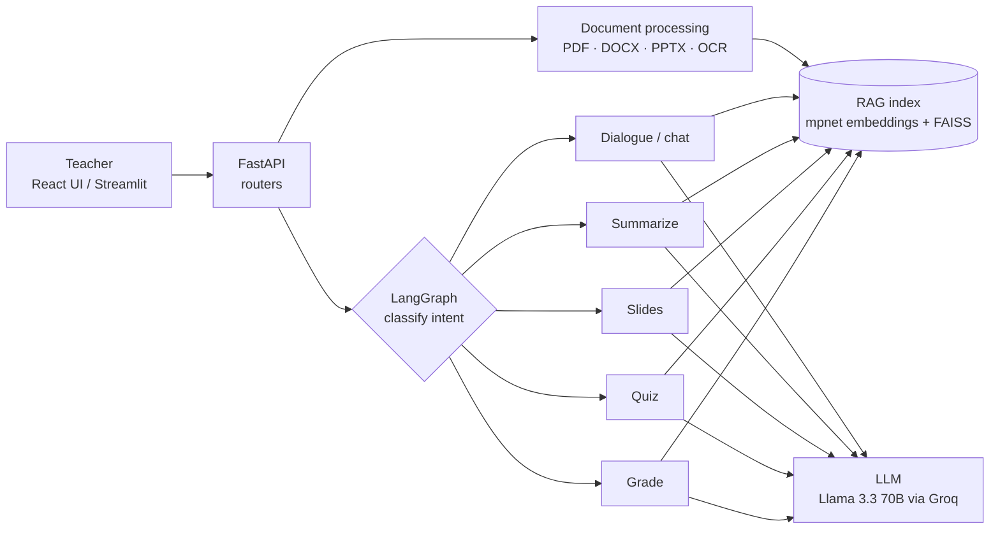

# Smart Teacher Assistant


A multi-agent LLM platform that turns a teacher's course material into teaching resources. The teacher uploads PDFs, Word files or slide decks; the system parses and indexes them in a retrieval-augmented generation (RAG) pipeline, and a LangGraph workflow routes each request to a specialised agent: summaries, slides, quizzes, grading rubrics, automatic grading, and chat with the documents.

Capstone project, Faculty of Engineering (ESIB), Université Saint-Joseph de Beyrouth, January – April 2026.

---

## What it does

| Agent | Input | Output |
|---|---|---|
| Summarizer | One or more course documents | Structured summary (map-reduce over chunks for long documents) |
| Quiz generator | Course document | MCQ, short-answer and true/false questions, exportable to Moodle XML |
| Slide generator | Course document | Slide deck with generated visuals, exported to PPTX / PDF |
| Rubric generator | Assignment description | Grading rubric with criteria and levels |
| Grading agent | Student submission + rubric | Per-criterion scores and written feedback |
| Chat with documents | Question | Answer grounded in the uploaded material, with cited sources (section, page) |
| Cross-document analysis | Several documents | Comparison and links between ideas across documents |

## Architecture



A single entry point, `POST /graph/invoke`, runs the whole workflow. With `intent: "auto"`, the first node asks the LLM to classify the request, then a conditional edge routes it to the matching agent node. Each agent retrieves the relevant chunks from the RAG index before calling the LLM, so answers are based on the teacher's own documents.

The main parts:

- Document processing: loaders and parsers for PDF, DOCX and PPTX, text cleaning, structure and table extraction, OCR for scanned pages (Tesseract), Arabic text support.
- RAG: chunking, `sentence-transformers/all-mpnet-base-v2` embeddings, FAISS inner-product index, retrieval with source metadata.
- Orchestration: LangGraph `StateGraph` (`app/services/agents/orchestration/assistant_graph.py`) with a shared typed state across nodes.
- Evaluation: dynamic rubric generation, rubric-based grading, feedback and analytics.
- API: FastAPI routers per module (`documents`, `rag`, `chat`, `agents`, `evaluation`, `graph`, `generate_slides`), OpenAPI docs at `/docs`.
- UI: React + TypeScript (Vite) app with Library, Dialogue, Summarize, Slides, Quiz and Grading pages; a Streamlit UI is also available.

## Team

| Member | Ownership |
|---|---|
| Jean Mardini | Technical lead: repository and architecture, LangGraph orchestration, global configuration, FastAPI layer, integration of all modules |
| Angela Nabhan | Summarizer, quiz and slide agents |
| Kristy Tannoury | Rubric and grading agents, evaluation logic |
| Marc Khattar | RAG pipeline, chat and cross-document agents |
| Matheos Touma | Document processing |

## Tech stack

Python · FastAPI · LangGraph / LangChain Core · Groq (Llama 3.3 70B) · sentence-transformers · FAISS · Hugging Face Transformers · pdfplumber / PyMuPDF / python-docx / python-pptx · Tesseract OCR · Playwright (slide export) · React + TypeScript (Vite) · Streamlit

---

## Running locally

Requirements: Python 3.10+, Node.js (for the web UI), a [Groq API key](https://console.groq.com). For scanned PDFs, install [Tesseract OCR](https://github.com/UB-Mannheim/tesseract/wiki) and add it to `PATH`.

### 1. Backend

```bash
git clone https://github.com/Jean-Mardini/Smart-Teacher-Assistant.git
cd Smart-Teacher-Assistant
python -m venv .venv
source .venv/bin/activate          # Windows: .\.venv\Scripts\Activate.ps1
pip install -r requirements.txt
cp .env.example .env               # then set GROQ_API_KEY (optional: HF_TOKEN, OPENAI_API_KEY for slide images)
python -m uvicorn app.main:app --reload --host 127.0.0.1 --port 8000
```

| URL | Purpose |
|---|---|
| http://127.0.0.1:8000/docs | OpenAPI / Swagger |
| http://127.0.0.1:8000/health | Health check |
| http://127.0.0.1:8000/graph/info | LangGraph nodes |
| `POST /graph/invoke` | Unified workflow (classify → dialogue / summarize / slides / quiz / grade) |

### 2. Web UI

```bash
cd frontend
npm install
npm run dev                        # opens on http://127.0.0.1:5173
```

The UI calls the API at `VITE_API_URL` (default `http://127.0.0.1:8000`). To change it, copy `frontend/.env.example` to `frontend/.env.local` and restart `npm run dev`.

### Optional: Streamlit UI

```bash
streamlit run streamlit_app.py     # http://127.0.0.1:8501
```

### Document processing demo

```bash
python demo_document_processing.py # parses the files in samples/, writes JSON to outputs/json/
```

---

## Project structure

```text
Smart-Teacher-Assistant/
├── app/
│   ├── main.py                        # FastAPI app, CORS, router registration
│   ├── core/config.py                 # global configuration
│   ├── api/routers/                   # documents, rag, chat, agents, evaluation, graph, slides
│   ├── models/                        # Pydantic request/response models
│   ├── prompts/                       # prompt templates (summaries, quiz, slides)
│   ├── services/
│   │   ├── document_processing/       # loaders, parsers, OCR, structure extraction
│   │   ├── rag/                       # chunker, embeddings, FAISS store, retriever
│   │   ├── knowledge/                 # chunking config, embeddings
│   │   ├── agents/                    # summarizer, quiz, slides, rubric, grading, chat, cross-doc
│   │   │   └── orchestration/         # LangGraph teaching workflow
│   │   ├── evaluation/                # rubrics, grading, feedback, analytics
│   │   └── llm/                       # Groq client
│   └── storage/                       # file and database storage
├── frontend/                          # React + TypeScript (Vite) UI
├── streamlit_app.py                   # alternative UI
├── scripts/                           # smoke tests
└── requirements.txt
```
